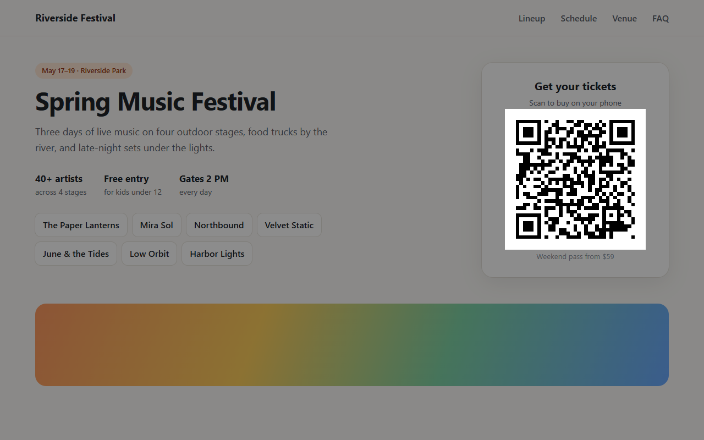
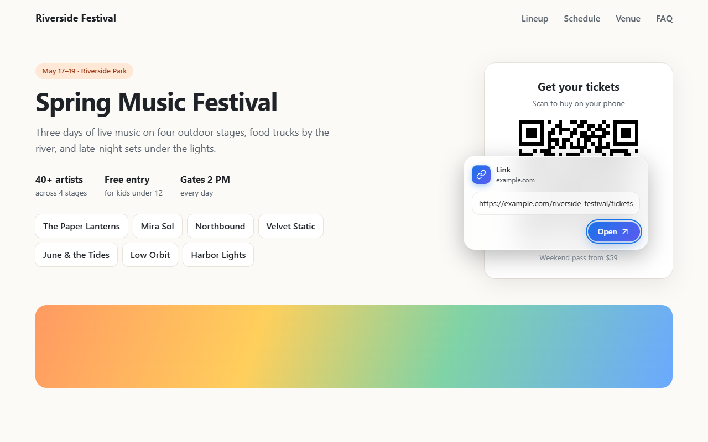
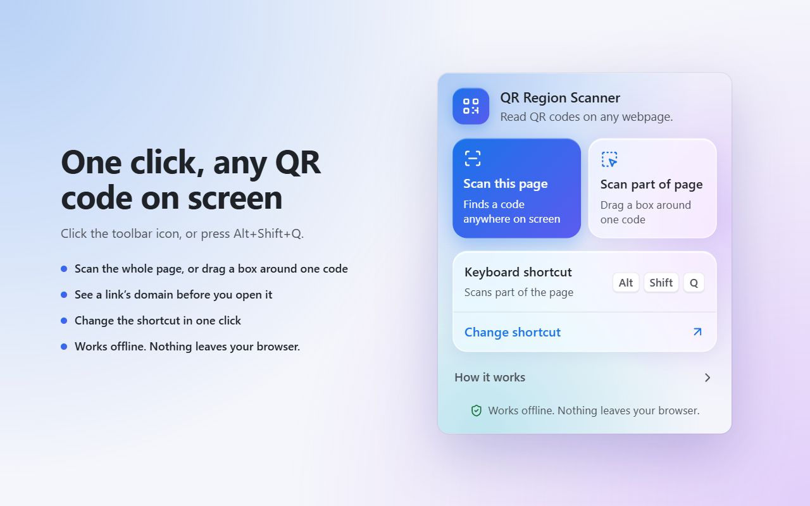
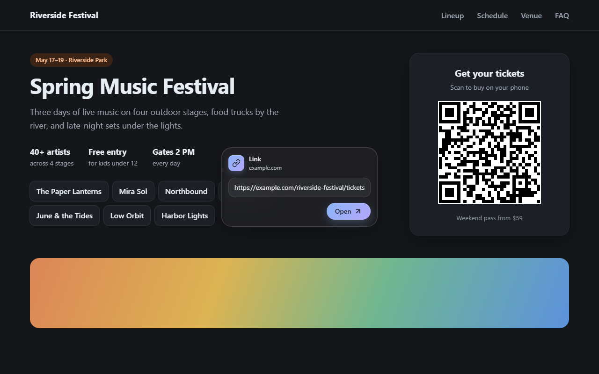

# QR Region Scanner

Snipping-tool-style QR scanner for Chromium browsers: press a shortcut, drag a box over a QR code on any webpage, and read it.

| Drag over a code | Get its value |
| --- | --- |
|  |  |
| **Toolbar popup** | **Scan the whole page (dark theme)** |
|  |  |

## Quick Start

1. Open `chrome://extensions` (or `edge://extensions`) and turn on **Developer mode**.
2. Click **Load unpacked** and select this folder.
3. A welcome tab opens with the shortcut and how to use it.
4. On any webpage, press **Alt+Shift+Q** and drag over a QR code. Or click the extension's icon → **Scan this page** to find it without dragging.

No build step and nothing to install. The folder is the extension. Full install, update, and test steps are in [SETUP.md](./SETUP.md).

## Features

- **Region select:** the page freezes under a dimmed overlay with a crosshair cursor, the same way Win+Shift+S does. Drag a box over the code.
- **Popup at the cursor:** opens just up-left of where you release the mouse, so its button is right under your pointer; kept inside the viewport. Press anywhere else to close it. Links are labeled with their domain so you can see where they go before opening. Frosted-glass look that follows your light/dark theme.
- **Smart action button:**
  - `http`/`https` link → **Open** (new tab)
  - anything else (text, Wi-Fi config, `mailto:`, …) → **Okay**
  - nothing found → "No QR code found" + **Okay**
- **Keyboard:** **Enter** runs the button, **Escape** cancels at any point.
- **Toolbar popup:** click the extension's icon to **Scan this page** (finds a QR code anywhere on screen, no dragging) or **Scan part of page** (drag a box, same as the shortcut), see your current shortcut, and jump to the page where you change it. The same page opens once as a welcome tab after install.
- **Works on tricky codes:** light-on-dark codes, high-DPI screens, browser zoom, and video frames (decoding uses the frozen frame).
- **Private and offline:** no network requests, no remote code. It only asks for `activeTab` + `scripting`, so it can see a page only when you press the shortcut.

Works in Chrome, Edge, Brave, Opera, and Vivaldi.

## Configuration

| Setting | Default | Change it at |
|---------|---------|--------------|
| Scan shortcut | `Alt+Shift+Q` | Extension icon → **Change**, or `chrome://extensions/shortcuts` / `edge://extensions/shortcuts` |

If the shortcut shows as unassigned, another extension already uses it, so pick a different one there.

**Limitations:** it can't run on browser-internal pages (`chrome://`, `edge://`, new tab), on the Chrome Web Store, or on Edge Add-ons. Codes need at least 2 screen pixels per module.

## Development

| File | Role |
|------|------|
| `manifest.json` | Manifest V3: shortcut, toolbar popup, and permissions |
| `background.js` | On shortcut or popup scan: captures the visible tab, injects the scanner. Opens the welcome tab on install |
| `content.js` | Overlay, drag selection, crop, decode, popup, keys |
| `popup.html`, `popup.js` | Toolbar popup and first-run welcome page |
| `icons/` | Extension icon (`icon.svg` source + PNG sizes) |
| `lib/jsQR.js` | Vendored QR decoder |
| `test/test.mjs` | Automated check of `content.js` in headless Chrome |
| `test/test.html` | Manual test page with sample QR codes |

```sh
node test/test.mjs   # needs Chrome + internet; exits 1 on failure
```

After changing code, click reload on the extension card, then reload the tab you're testing.

## Documentation

- [SETUP.md](./SETUP.md): install, update, manual test checklist, publishing
- [CLAUDE.md](./CLAUDE.md): spec, architecture, and design decisions

## License

[MIT](./LICENSE) © 2026 Brian Nich. The bundled [jsQR](https://github.com/cozmo/jsQR) decoder keeps its own Apache-2.0 license; see [lib/jsQR.LICENSE](./lib/jsQR.LICENSE).
